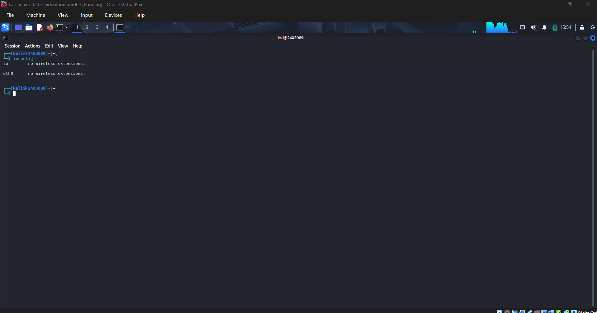
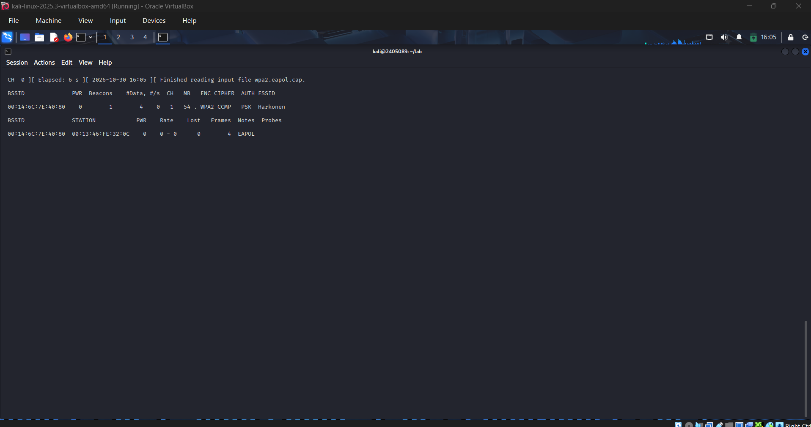
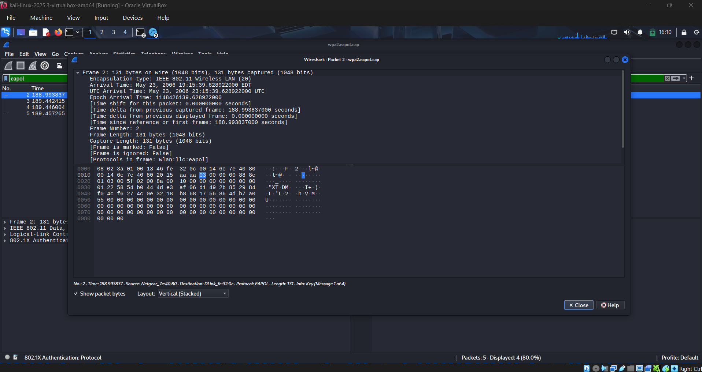
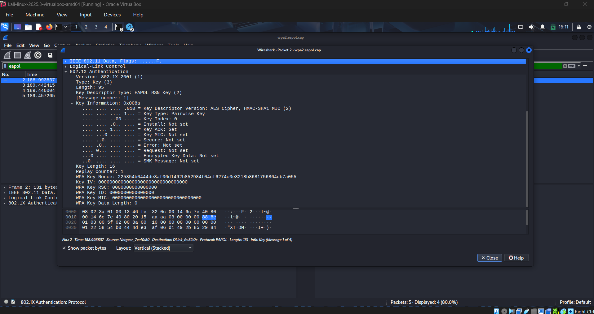
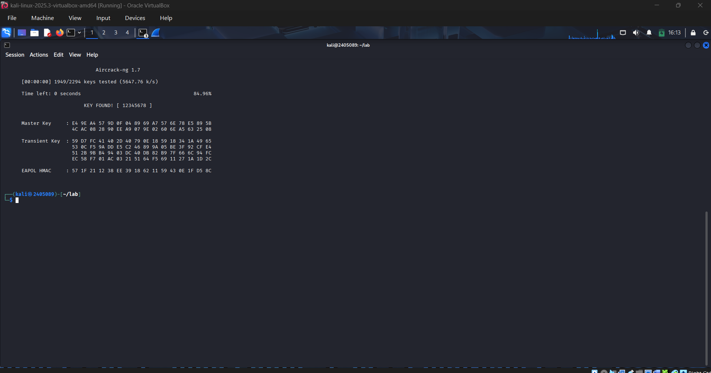
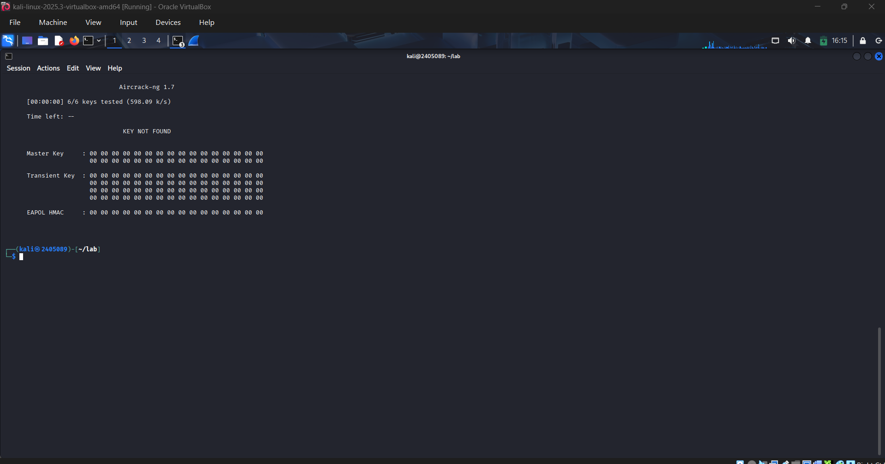
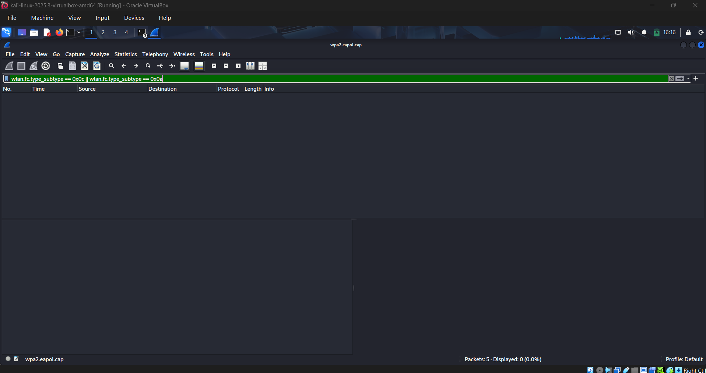

# تحليل WPA2 Handshake واسترجاع الباسورد بشكل تحكّمي (Controlled)

🌐 **Read this in:** [English](README.md) | **العربية**

**ورقة عمل (writeup) بتشرح تحليل الـ WPA2 4-way handshake باستخدام Wireshark، واسترجاع الباسورد offline باستخدام Aircrack-ng.**

> ⚠️ **تنويه:** التجربة دي اتعملت بالكامل على ملف capture رسمي ومُتاح للجميع (`wpa2.eapol.cap`) من مشروع Aircrack-ng نفسه، مُخصص للتعليم والاختبار — مفيش أي شبكة حقيقية، أو access point حقيقي، أو طرف تالت اتستهدف هنا. عمل أي هجوم على شبكات لاسلكية من غير إذن صريح من صاحبها **غير قانوني وغير أخلاقي**. كل اللي اتعمل هنا هو تحليل offline لملف تم التقاطه مسبقًا.

---

## الهدف

فهم وتوضيح المفاهيم الأمنية وراء WPA2-PSK من خلال:

- فحص الـ WPA2 4-way handshake على مستوى الـ packets في Wireshark
- تنفيذ هجوم dictionary attack بشكل offline ضد الـ handshake باستخدام Aircrack-ng
- المقارنة بين محاولة ناجحة (الباسورد موجود في الـ wordlist) ومحاولة فاشلة (الباسورد مش موجود) لتوضيح *ليه* هجمات الـ dictionary بتنجح أو بتفشل
- فحص نفس الـ capture للتأكد من وجود أو عدم وجود نشاط deauthentication/disassociation، من منظور دفاعي (defensive) يركّز على اكتشاف الهجمات

---

## بيئة المعمل (Lab Environment)

| | |
|---|---|
| **الجهاز المضيف (Host)** | Windows, Oracle VirtualBox |
| **نظام التشغيل الضيف (Guest OS)** | Kali Linux 2025.3 |
| **الأدوات** | Wireshark, Aircrack-ng suite (`airodump-ng`, `aircrack-ng`) |
| **البيانات المستخدمة** | `wpa2.eapol.cap` + `password.lst` — ملفات اختبار رسمية من مشروع Aircrack-ng ([المصدر](https://github.com/aircrack-ng/aircrack-ng/tree/master/test)) |

### ملاحظة عن الـ Monitor Mode

التجربة دي اتعملت جوه VM على VirtualBox من غير أي USB WiFi adapter متوصّل، وVirtualBox أصلًا مبيديش الـ VM وصول لكارت الـ WiFi بتاع الجهاز الأساسي كـ wireless interface. فبدل ما نعمل capture حي (live)، اتعمل التحليل على ملف capture رسمي ومُعتمد — وده أسلوب شائع جدًا ومقبول في التعلم (وهو بالظبط اللي مشروع Aircrack-ng بيوفر الملف عشانه).

```
$ iwconfig
lo        no wireless extensions.
eth0      no wireless extensions.
```



مفيش `wlan0` خالص — ده بيأكد إنه معندناش حاجة نحطها في monitor mode أصلًا.

---

## الخطوة 1 — استكشاف الشبكة من داخل الـ Capture

بدل ما نعمل مسح حي (live scan) بـ `airodump-ng`، اتقرا ملف الـ capture مباشرة:

```bash
sudo airodump-ng -r wpa2.eapol.cap
```



ده كشف كل اللي محتاجينه عشان نحدد الشبكة المستهدفة والجهاز المتصل بيها:

| الحقل | القيمة |
|---|---|
| SSID | `Harkonen` |
| BSSID | `00:14:6C:7E:40:80` |
| القناة (Channel) | `1` |
| التشفير | WPA2, cipher CCMP, auth PSK |
| جهاز العميل (Client station) | `00:13:46:FE:32:0C` |

---

## الخطوة 2 — التحقق من الـ 4-Way Handshake في Wireshark

```bash
wireshark wpa2.eapol.cap
```

الفلتر المستخدم: `eapol`



كل الـ **أربع رسايل EAPOL** موجودين:

```
Packet 2 — Message 1 of 4   (AP ← Client)
Packet 3 — Message 2 of 4   (Client → AP)
Packet 4 — Message 3 of 4   (AP → Client)
Packet 5 — Message 4 of 4   (Client → AP)
```

لما فتحنا تفاصيل `802.1X Authentication → Key Information` للرسالة الأولى (Message 1)، لقينا ده بيأكد كلام Wireshark بشكل مستقل — `Key ACK: Set`، `Install: Not set`، `Key MIC: Not set`، وده بالظبط المتوقع لما الـ AP بيبعت الـ nonce بتاعه لأول مرة:



**ليه ده مهم:** الـ 4-way handshake بيخلي الـ AP والـ client — واللي أصلًا الاتنين عندهم نفس الـ Pairwise Master Key، المشتق من الـ PSK والـ SSID — يثبتوا لبعض إنهم عارفين المفتاح ده (عن طريق Message Integrity Code)، ويتفقوا على session key، من غير ما الباسورد نفسه ينبعت في الهوا خالص. التقاط الـ handshake ده بيدّي المهاجم حاجة يختبر عليها تخميناته offline — مش الباسورد مباشرة.

كون الأربع رسايل كلهم بنفس الـ source/destination MACs وبنفس تسلسل الـ replay counters، ده بيأكد إن ده handshake واحد كامل وصالح للاستخدام — مش حكم بُني على مجرد ظهور "كام packet EAPOL" بالصدفة.

---

## الخطوة 3 — هجوم Dictionary بشكل Offline

### المحاولة الأولى — الباسورد موجود في الـ wordlist

```bash
aircrack-ng -w password.lst -b 00:14:6C:7E:40:80 wpa2.eapol.cap
```



```
KEY FOUND! [ 12345678 ]
1949/2294 keys tested (84.96%)
```

اتكسر على طول — `12345678` من أشهر الباسوردات اللي بتكون موجودة في أي wordlist عادي.

### المحاولة التانية — الباسورد مش موجود عمدًا

اتعمل wordlist تاني مخصوص من غير الباسورد الصح، عشان نوضح النتيجة التانية:

```bash
aircrack-ng -w wrong_wordlist.txt -b 00:14:6C:7E:40:80 wpa2.eapol.cap
```



```
KEY NOT FOUND
6/6 keys tested
```

**نفس الـ capture، نفس الأداة، نفس الـ handshake — الحاجة الوحيدة اللي اتغيرت هي محتوى الـ wordlist.** وده أساس فكرة الـ offline cracking كلها: محاولة فشلت مبتثبتش إن الباسورد قوي، كل اللي بتثبته إن الباسورد مش موجود في اللستة دي بالذات. أداة `aircrack-ng` بتشتغل عن طريق اشتقاق مفتاح من كل كلمة مرشحة والتحقق لو الـ MIC الناتج بيطابق اللي اتلقط في الـ handshake — لو الباسورد الحقيقي مظهرش كمرشح أصلًا، التحقق مش هينجح أبدًا، مهما كانت الشبكة "سهلة الكسر" في الأساس.

---

## الخطوة 4 — فحص مؤشرات الهجوم (Deauth/Disassoc)

نشوف دلوقتي من منظور دفاعي: فريمات الـ deauthentication والـ disassociation هي العلامة الكلاسيكية لهجوم فصل إجباري (forced-disconnect)، لأن في WPA2 الفريمات دي (management frames) **مش مشفرة ومش موثّقة (unauthenticated)** — يعني أي حد يقدر يزورها.

```
الفلتر: wlan.fc.type_subtype == 0x0c || wlan.fc.type_subtype == 0x0a
```



**النتيجة: صفر packets مطابقين.** الـ capture ده فيه بس beacon وhandshake نضيف — مفيش أي دليل على هجوم deauthentication. مهم نوضح ده بشكل صريح: *عدم وجود* الفريمات دي في عينة قصيرة (5 packets بس) مبيثبتش إن الشبكة دي معملهاش أي هجوم زي ده قبل كده — ده بس بيعكس اللي موجود في الـ capture المحدود ده. أي تحقيق حقيقي محتاج capture أطول ومستمر، مربوط بلوجات الـ AP نفسه.

---

## أهم النقاط المستفادة

- **التقاط الـ handshake مش معناه الوصول للباسورد.** الباسورد مبيتبعتش خالص، بس بيتبعت إثبات تشفيري إن الطرفين عارفين الباسورد. الكسر لسه محتاج إن الباسورد الحقيقي يكون موجود كمرشح في الـ wordlist.
- **الباسوردات الضعيفة هي المشكلة الحقيقية، مش WPA2 نفسه.** `12345678` اتكسر في أقل من ثانية؛ لو الباسورد كان طويل وفريد، الـ capture ده كان هيبقى عديم الفايدة للمهاجم تقريبًا.
- **فشل هجوم dictionary مش دليل على الأمان.** ده بس بيستبعد الـ wordlist المحددة اللي اتجربت.
- **فريمات الـ deauth/disassoc ممكن تتزوّر في WPA2** لأن management frames مش محمية أصلًا — وده بالظبط اللي ميزة 802.11w (Management Frame Protection) اتعملت عشان تحله.

## التوصيات الدفاعية

1. استخدم باسورد طويل وفريد (15 حرف على الأقل) — ابتعد عن أي حاجة قريبة من كلمات القاموس.
2. فضّل **WPA3** لو متاح — الـ handshake بتاعه (SAE) بيقاوم هجمات الـ dictionary بشكل offline خالص.
3. حافظ على تحديث الـ firmware بتاع الراوتر/الـ AP باستمرار.
4. عطّل خاصية WPS لو مش مستخدمها.
5. فعّل **802.11w (Management Frame Protection)** عشان تمنع تزوير فريمات الـ deauth/disassoc.
6. استخدم نظام بسيط لاكتشاف التسلل اللاسلكي (WIDS) عشان يرصد أي كمية غير طبيعية من فريمات الـ deauth/disassoc.

---

## المراجع

- [Aircrack-ng Documentation](https://www.aircrack-ng.org/documentation.html)
- [Aircrack-ng sample test files](https://github.com/aircrack-ng/aircrack-ng/tree/master/test)
- [Wireshark Sample Captures](https://wiki.wireshark.org/SampleCaptures)
- [Wireshark](https://www.wireshark.org/)
