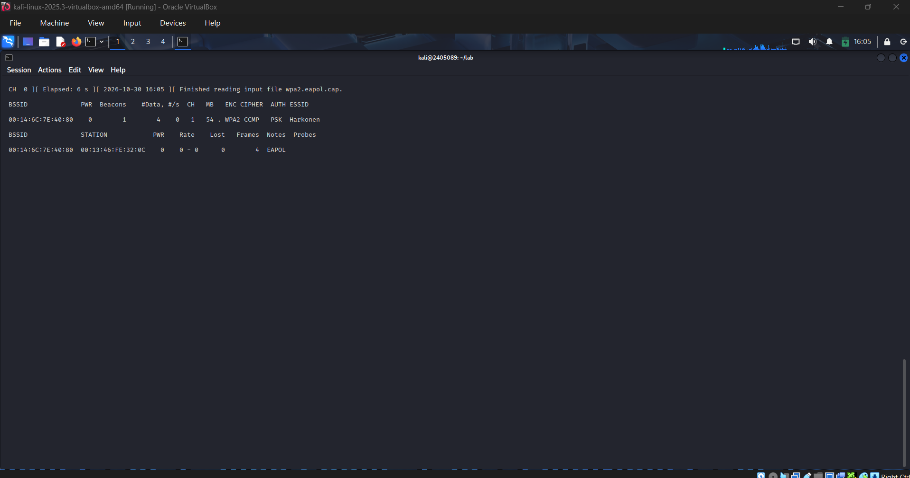
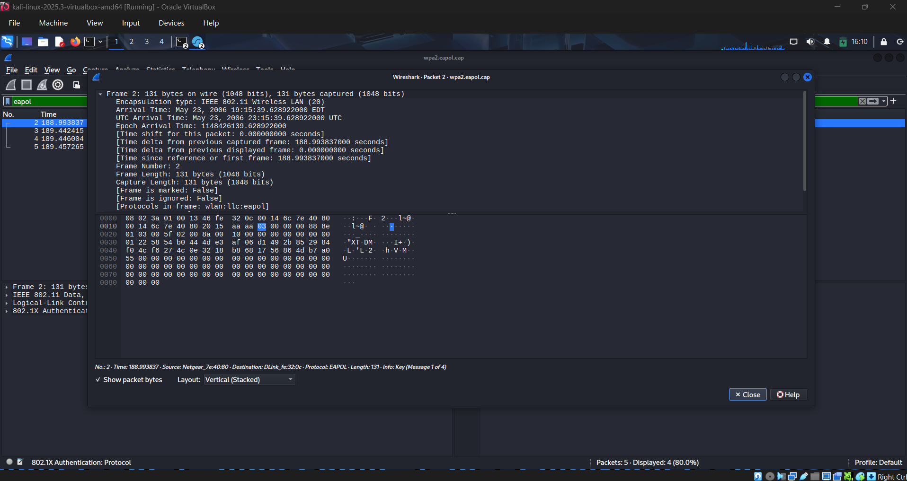
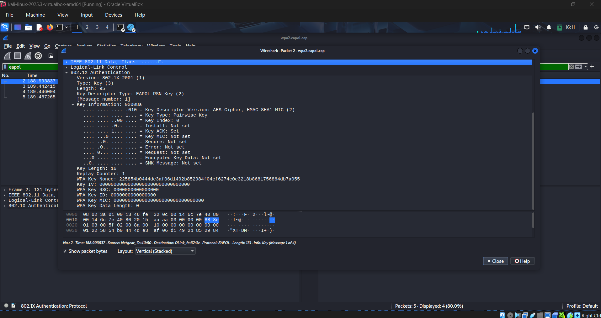
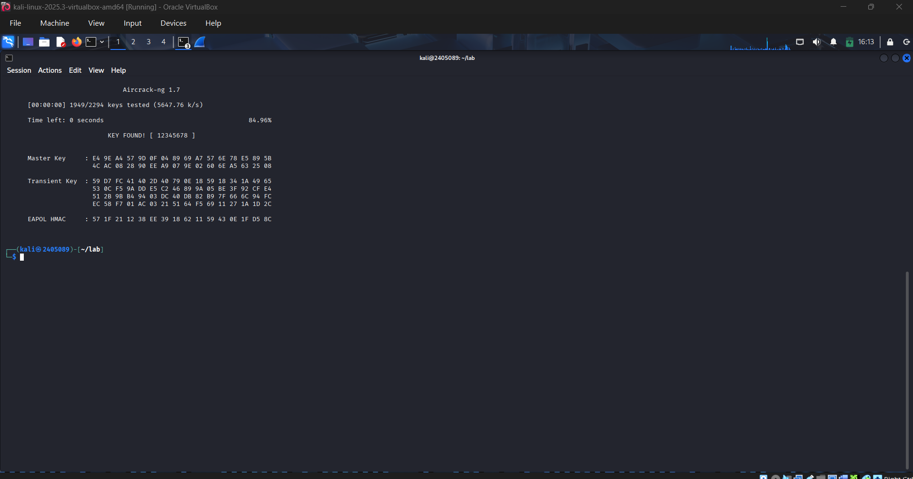
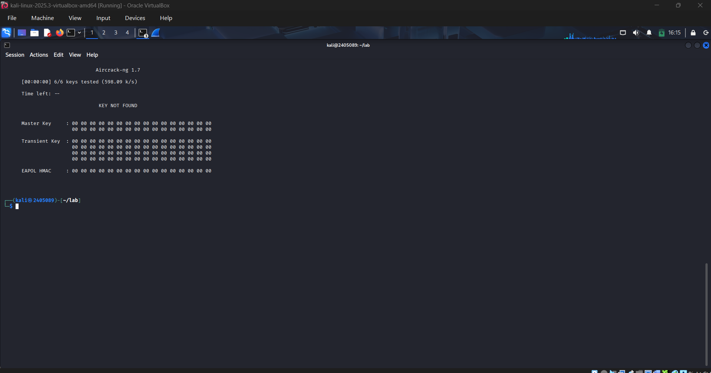
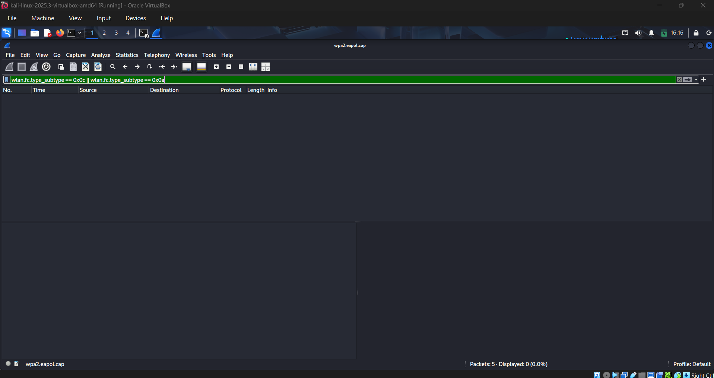

# WPA2 Handshake Analysis & Controlled Password Recovery

🌐 **Read this in:** **English** | [العربية](README.ar.md)

**A lab writeup covering WPA2 4-way handshake analysis in Wireshark and offline password recovery with Aircrack-ng.**

> ⚠️ **Disclaimer:** This lab was performed entirely against an authorized, publicly distributed sample capture file (`wpa2.eapol.cap`) provided by the Aircrack-ng project for testing and educational purposes — no live network, real access point, or third party was targeted. Performing wireless attacks against networks you do not own or have explicit permission to test is illegal and unethical. All activity here is offline analysis of a pre-captured file.

---

## Objective

Understand and demonstrate the security mechanics behind WPA2-PSK by:

- Inspecting a WPA2 4-way handshake at the packet level in Wireshark
- Running an offline dictionary attack against the handshake with Aircrack-ng
- Comparing a successful crack (password in wordlist) against a failed one (password absent) to show *why* dictionary attacks succeed or fail
- Checking the same capture for deauthentication/disassociation activity from a defensive, detection-focused angle

---

## Lab Environment

| | |
|---|---|
| **Host** | Windows, Oracle VirtualBox |
| **Guest OS** | Kali Linux 2025.3 |
| **Tools** | Wireshark, Aircrack-ng suite (`airodump-ng`, `aircrack-ng`) |
| **Dataset** | `wpa2.eapol.cap` + `password.lst` — official Aircrack-ng test files ([source](https://github.com/aircrack-ng/aircrack-ng/tree/master/test)) |

### A note on monitor mode

This lab was run inside a VirtualBox VM with **no USB WiFi adapter passed through**, and VirtualBox does not expose the host's built-in WiFi card to guest VMs as a wireless interface. So instead of a live capture, this writeup works from an authorized sample capture — which is a perfectly valid, common way to learn this material (it's literally what Aircrack-ng ships the file for).

```
$ iwconfig
lo        no wireless extensions.
eth0      no wireless extensions.
```


No `wlan0` — confirming there's nothing to put into monitor mode here.

---

## Step 1 — Reconnaissance on the Capture

Rather than a live `airodump-ng` scan, the sample capture was read directly:

```bash
sudo airodump-ng -r wpa2.eapol.cap
```



This revealed everything needed to identify the target network and its connected client:

| Field | Value |
|---|---|
| SSID | `Harkonen` |
| BSSID | `00:14:6C:7E:40:80` |
| Channel | `1` |
| Encryption | WPA2, cipher CCMP, auth PSK |
| Client station | `00:13:46:FE:32:0C` |

---

## Step 2 — Verifying the 4-Way Handshake in Wireshark

```bash
wireshark wpa2.eapol.cap
```

Filter applied: `eapol`



All **four EAPOL messages** are present and accounted for:

```
Packet 2 — Message 1 of 4   (AP → Client)
Packet 3 — Message 2 of 4   (Client → AP)
Packet 4 — Message 3 of 4   (AP → Client)
Packet 5 — Message 4 of 4   (Client → AP)
```

Expanding the `802.1X Authentication → Key Information` fields on Message 1 confirms it independently of Wireshark's own labeling — `Key ACK: Set`, `Install: Not set`, `Key MIC: Not set`, which is exactly what's expected for an AP's opening nonce delivery:



**Why this matters:** the 4-way handshake lets the AP and client — both already holding the same Pairwise Master Key, derived from the PSK and SSID — prove they each know it (via a Message Integrity Code) and agree on a session key, all *without* ever transmitting the passphrase itself. Capturing this exchange gives an attacker something to test guesses against offline — not the password directly.

All four messages sharing consistent source/destination MACs and sequential replay counters confirms this is one complete, usable handshake — not a judgment made from "a few EAPOL packets happened to show up."

---

## Step 3 — Offline Dictionary Attack

### Run 1 — password in the wordlist

```bash
aircrack-ng -w password.lst -b 00:14:6C:7E:40:80 wpa2.eapol.cap
```



```
KEY FOUND! [ 12345678 ]
1949/2294 keys tested (84.96%)
```

Cracked almost instantly — `12345678` sits near the top of most common-password wordlists.

### Run 2 — password deliberately excluded

A second, custom wordlist was built *without* the real password, to demonstrate the other outcome:

```bash
aircrack-ng -w wrong_wordlist.txt -b 00:14:6C:7E:40:80 wpa2.eapol.cap
```



```
KEY NOT FOUND
6/6 keys tested
```

**Same capture, same tool, same handshake — the only variable was wordlist content.** This is the core lesson of offline cracking: a failed attempt proves nothing about password strength on its own; it only proves the password wasn't in that particular list. `aircrack-ng` works by deriving key material from each candidate word and checking whether the resulting MIC matches the one captured — if the real passphrase never appears as a candidate, the check can never succeed, no matter how "crackable" the network might otherwise be.

---

## Step 4 — Checking for Attack Indicators (Deauth/Disassoc)

Flipping to a defensive lens: deauthentication and disassociation frames are the classic signature of a forced-disconnect attack, since in WPA2 these management frames are **unencrypted and unauthenticated** — anyone can forge one.

```
Filter: wlan.fc.type_subtype == 0x0c || wlan.fc.type_subtype == 0x0a
```



**Result: 0 matching packets.** This capture contains only a beacon and a clean handshake — no evidence of a deauthentication attack. Worth noting explicitly: the *absence* of these frames in a short, 5-packet sample doesn't prove no such attack has ever happened on this network — it only reflects what this particular capture contains. A real investigation would need a longer, continuous capture correlated with AP-side logs.

---

## Key Takeaways

- **Capturing a handshake ≠ having the password.** The password is never transmitted; only a cryptographic proof that both sides know it. Cracking still requires the real password to exist as a candidate in your wordlist.
- **Weak passwords are the real vulnerability**, not WPA2 itself. `12345678` fell in under a second; a long, unique passphrase would have made this capture practically useless to an attacker.
- **A failed dictionary attack is not evidence of safety.** It only rules out the specific wordlist used.
- **Deauth/disassoc frames are forgeable in WPA2** because management frames aren't protected — this is exactly what 802.11w (Management Frame Protection) exists to fix.

## Defensive Recommendations

1. Use a long, unique passphrase (15+ characters) — avoid anything dictionary-adjacent.
2. Prefer **WPA3** where supported — its SAE handshake resists offline dictionary attacks entirely.
3. Keep AP/router firmware up to date.
4. Disable WPS if it isn't in use.
5. Enable **802.11w (Management Frame Protection)** to prevent forged deauth/disassoc frames.
6. Deploy basic wireless intrusion detection to flag abnormal volumes of deauth/disassoc traffic.

---

## References

- [Aircrack-ng Documentation](https://www.aircrack-ng.org/documentation.html)
- [Aircrack-ng sample test files](https://github.com/aircrack-ng/aircrack-ng/tree/master/test)
- [Wireshark Sample Captures](https://wiki.wireshark.org/SampleCaptures)
- [Wireshark](https://www.wireshark.org/)
